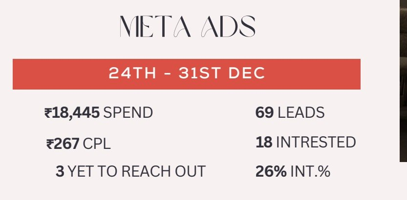
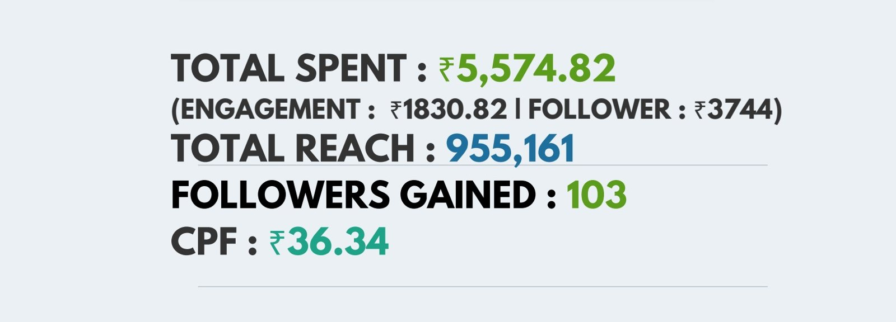
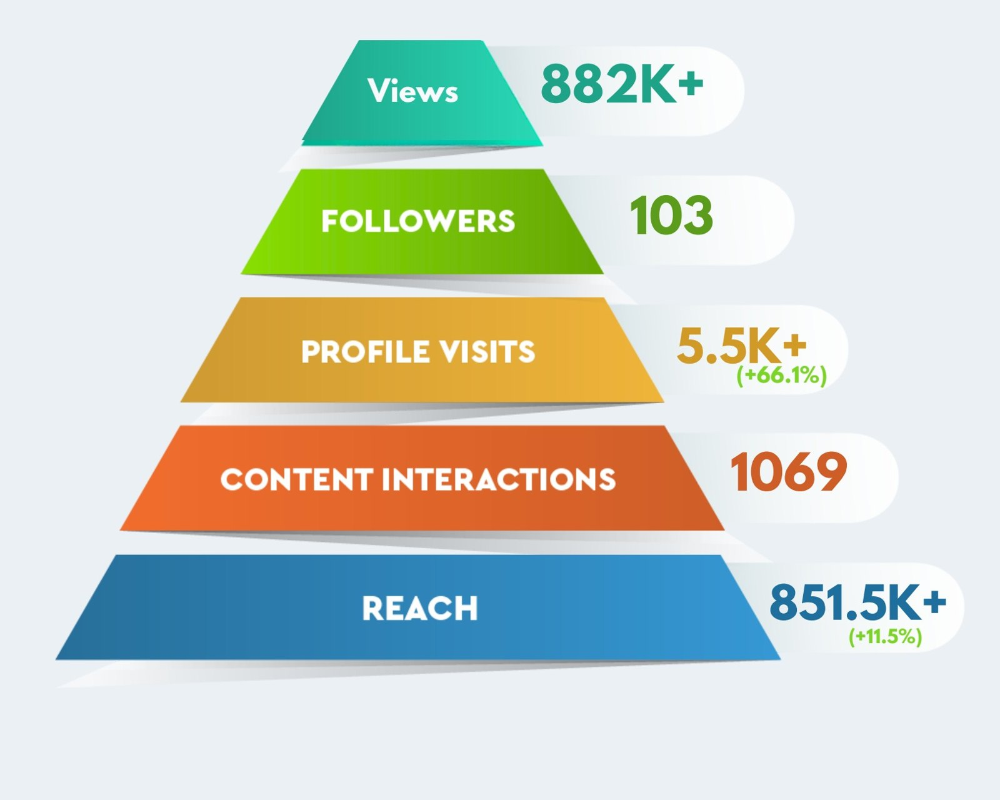

# Rashmi Lahoti
### Digital Marketing · Brand Strategy · Business Growth

**From building an apparel label to agency leadership and hospitality marketing, I connect brand storytelling with practical business execution.** My experience spans content, campaigns, client relationships, community building and team leadership.

## [Explore my live portfolio →](https://labelgaurishan-dot.github.io/rashmi-lahoti/)

[Selected work](https://labelgaurishan-dot.github.io/rashmi-lahoti/#work) · [Writing samples](https://labelgaurishan-dot.github.io/rashmi-lahoti/#writing) · [LinkedIn](https://www.linkedin.com/in/rashmi-lahoti) · [Email me](mailto:rashmi_lahoti1990@hotmail.com)

**Open to international remote opportunities** in digital marketing, brand strategy and marketing leadership.

## What I bring

- **Marketing strategy:** positioning, campaign concepts, content calendars and integrated channel planning.
- **Content & communication:** social copy, reel scripts, creative briefs, LinkedIn and personalized email outreach.
- **Business leadership:** client relationships, business development, budgets, P&L and cross-functional delivery.
- **Community & customer experience:** partnerships, events, influencer outreach and hospitality marketing.

## Selected company case studies

### Crimson Cup Cafe — Hospitality & community
*Chief Marketing Officer · June–October 2026, as listed in my existing portfolio*

**Focus:** connect the cafe's food, art and community experience with its digital presence and local partnerships.

**Contribution:** led social media and content, influencer outreach, personalized email marketing, community partnerships and event programming. Responsibilities also included menu positioning, budgets, hiring, vendors and operations.

**Work to explore:** venue and community photographs, plus event collaboration copy, in the [live case study](https://labelgaurishan-dot.github.io/rashmi-lahoti/#work). [Visit the brand's Instagram](https://www.instagram.com/crimsoncupcafe/).

### Bluetick Consultants — Agency strategy & delivery
*January 2020–July 2026 · Project Manager → Vertical Head → Chief Business Officer (2023), as listed in my existing portfolio*

**Focus:** develop client marketing strategies while building agency delivery and business development capabilities.

**Contribution:** directed campaign concepts, content planning and creative execution across social, LinkedIn and email; coordinated paid-media teams across Meta, LinkedIn and Google Ads; managed client relationships, vertical budgets and team delivery.

**Career highlights:** my existing portfolio reports supporting agency growth from 8 to 120+ people, managing 30+ client accounts, and building a business development vertical that brought in 31 clients in one year. These are owner-reported experience claims; the repository does not include independent supporting records.

**Work to explore:** social, paid-media and lead-generation report excerpts below, alongside [writing samples](https://labelgaurishan-dot.github.io/rashmi-lahoti/#writing). Client identities are withheld.

### Label Gauri — Fashion entrepreneurship
*Founder / apparel label operator · April 2014–January 2020, as listed in my existing portfolio*

**Focus:** build a fashion brand from product concept through customer acquisition and sales.

**Contribution:** owned product concepts, marketing, hiring, operations and revenue management. Built Instagram and Facebook presence, managed exhibitions and customer relationships, and handled order conversion.

**Work to explore:** occasionwear, collection imagery and garment details in the [live portfolio](https://labelgaurishan-dot.github.io/rashmi-lahoti/#work), with existing photography credits retained.

## Campaign results supported by supplied report excerpts

The figures below were checked against report images already embedded in the existing portfolio. They are **reported campaign outcomes**, not independently audited results or claims of sole personal attribution. The portfolio places these samples under Bluetick Consultants; individual responsibilities remain awaiting confirmation.

| Sample | Figures visible in the supplied excerpt | Evidence |
| --- | --- | --- |
| Lead generation | 69 leads; ₹18,445 spend; reported ₹267 cost per lead; 18 interested leads | [Open report](assets/portfolio/lead-generation-report.jpg) |
| Paid media | 103 followers gained; ₹5,574.82 total spend; ₹3,744 follower-campaign spend; reported ₹36.34 cost per follower | [Open report](assets/portfolio/paid-media-report.jpg) |
| Social media | 882K+ views; 5.5K+ profile visits; 1,069 content interactions; 851.5K+ reach | [Open report](assets/portfolio/social-report.jpg) |

The existing portfolio labels the lead-generation sample December 2025 and the social/paid-media samples June 2026. The cropped images do not independently establish the full dates. Cost per follower relates to the follower-campaign spend, rather than total advertising spend. Leads are not completed sales, and the reach figures in the separate reports should not be combined.

### Lead-generation report

### Paid-media report

View the social media report excerpt

The cafe's sales-growth percentage is omitted here because its September–March reporting period conflicts with the listed June–October 2026 role dates and supporting records remain pending. Performance claims inside example outreach emails are writing samples, rather than verified achievements.

## Writing & creative range

Explore audience-specific work in the [writing section](https://labelgaurishan-dot.github.io/rashmi-lahoti/#writing):

- Emotional storytelling, quirky / meme content, informative posts, educational UGC and brand communication.
- Admission-enquiry email copy and event partnership outreach.

## Let's connect

**Rashmi Lahoti**  
[LinkedIn](https://www.linkedin.com/in/rashmi-lahoti) · [rashmi_lahoti1990@hotmail.com](mailto:rashmi_lahoti1990@hotmail.com)  
[Open the live portfolio and download my resume](https://labelgaurishan-dot.github.io/rashmi-lahoti/#contact)

---

*Work samples belong to their respective brands. They are shared to illustrate my contribution; brand ownership and existing photography credits remain with their respective owners.*

*This README is the portfolio landing page on github.com. GitHub displays it within its repository interface; the full website, galleries and interactive experience are available through the live portfolio link above.*
